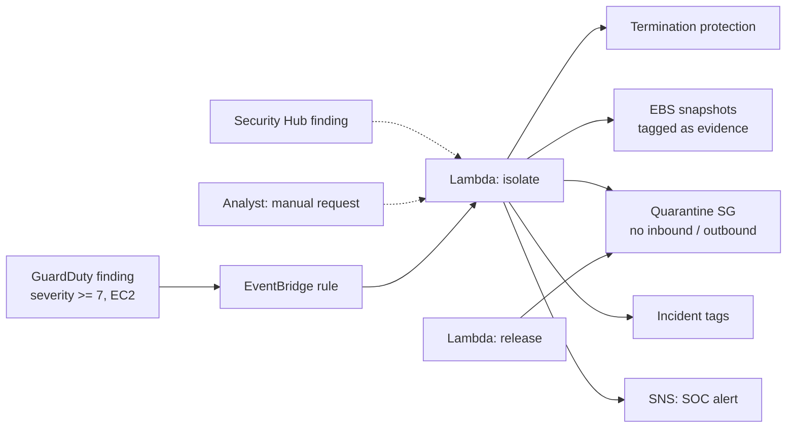

# AWS EC2 Auto-Isolation

Automated containment for compromised EC2 instances. When GuardDuty (or Security Hub) raises a high-severity finding on an instance, an EventBridge rule triggers a Lambda that **preserves evidence, cuts the instance off the network, tags it, and alerts the SOC**. That usually happens within seconds, before an analyst has even opened the alert.

A second Lambda **releases** the instance once the investigation is closed, restoring its original security groups.

## What it does

When a finding arrives (for example `Backdoor:EC2/C&CActivity.B!DNS`, severity 8), the isolation Lambda runs these steps in order:

1. **Enable termination protection**, so nobody (attacker or operator) can destroy the evidence
2. **Snapshot every attached EBS volume**, tagged with the finding ID, for disk forensics
3. **Get or create a quarantine security group** in the instance's VPC with **no inbound and no outbound rules**
4. **Swap every network interface** onto the quarantine group, recording the original groups
5. **Tag the instance** with `SecurityStatus=Quarantined`, the finding ID and type, the time, and its original SGs
6. **Notify the SOC** through SNS (email, Slack via AWS Chatbot, PagerDuty and so on)

Evidence is preserved **before** the network is cut, so even if a later step fails, nothing is lost.

## Safety controls

| Control | Why |
|---|---|
| `MIN_SEVERITY` (default 7) | Only HIGH findings trigger automatic action; lower ones are ignored |
| `IsolationExempt=true` tag | Lets critical systems opt out of automatic containment and go to manual review |
| Idempotent | A second finding on an already-quarantined instance does nothing |
| `DRY_RUN=true` | Logs the full plan without changing anything. **Terraform deploys in dry-run by default** |
| Release function | One-call rollback, using the original SGs recorded on the instance |

## Architecture



## Supported triggers

- **GuardDuty** findings through EventBridge (primary)
- **Security Hub** findings (ASFF format, `AwsEc2Instance` resources)
- **Manual**: `{"instance_id": "i-0abc...", "ticket": "INC-4471", "reason": "..."}` for analyst-driven containment

## Try it locally (no AWS account needed)

The simulation runs the full flow against a mocked AWS account using [moto](https://github.com/getmoto/moto):

```bash
python -m venv .venv && source .venv/bin/activate
pip install -r requirements-dev.txt
python scripts/simulate.py --release
```

```
=== GuardDuty finding received ==================================
Backdoor:EC2/C&CActivity.B!DNS  severity 8

=== Lambda: auto-isolation ======================================
  [done] Enable termination protection
  [done] Snapshot attached EBS volumes for forensics
  [done] Get or create quarantine security group
  [done] Swap eni-c1ba43a9f4f662cab to quarantine SG
  [done] Tag instance with incident details

Status: ISOLATED

=== SOC notification (SNS) ======================================
Subject: [HIGH] EC2 i-c5fc1a2a0796236d7 isolated
...
=== Investigation closed: release ===============================
  [done] Restore eni-c1ba43a9f4f662cab security groups
  [done] Mark instance as released
```

## Deploy to AWS (Terraform)

Prerequisites: Terraform 1.5 or later, AWS credentials, and GuardDuty enabled in the region.

```bash
./scripts/package.sh                 # builds build/lambda.zip
cd infra
terraform init
terraform apply -var="alert_email=soc@example.com"
```

This creates the SNS topic, a least-privilege IAM role, both Lambdas, the EventBridge rule and a log group. It deploys with **`dry_run = true`**. Review a few real findings in CloudWatch Logs first, then enable enforcement:

```bash
terraform apply -var="dry_run=false"
```

Release an instance after the investigation:

```bash
aws lambda invoke --function-name ir-ec2-isolation-release \
  --payload '{"instance_id":"i-0abc123"}' --cli-binary-format raw-in-base64-out out.json
```

## Tests

```bash
pytest -q
```

The 11 tests run against moto and cover: full isolation, a quarantine SG with zero rules, reuse of the quarantine SG, the low-severity ignore, the exempt tag, idempotency, dry-run, the SNS notification, release/rollback, Security Hub and manual event parsing, and non-EC2 findings.

## Project structure

```
isolation/
  finding.py    parses GuardDuty, Security Hub and manual events into one Finding
  isolate.py    containment and release actions (the playbook)
  notify.py     SOC message and SNS publish
  handler.py    Lambda entry points: lambda_handler, release_handler
infra/          Terraform: Lambda, IAM, EventBridge, SNS, logs
events/         sample GuardDuty finding
scripts/        simulate.py (local demo), package.sh (build the zip)
tests/          pytest + moto
```

## Limitations and next steps

- **Tracked connections:** security-group changes don't kill connections that are already established. For a hard cut, add a deny-all network ACL on a dedicated forensic subnet, or move the ENI there.
- **Auto Scaling groups:** an isolated instance in an ASG may be replaced or terminated. A next step is to detach it from the ASG first.
- **Memory capture:** add an SSM Run Command step to capture memory (for example with AVML) before isolation.
- **Step Functions:** move the steps into a Step Functions workflow with a manual-approval stage for MEDIUM findings.
